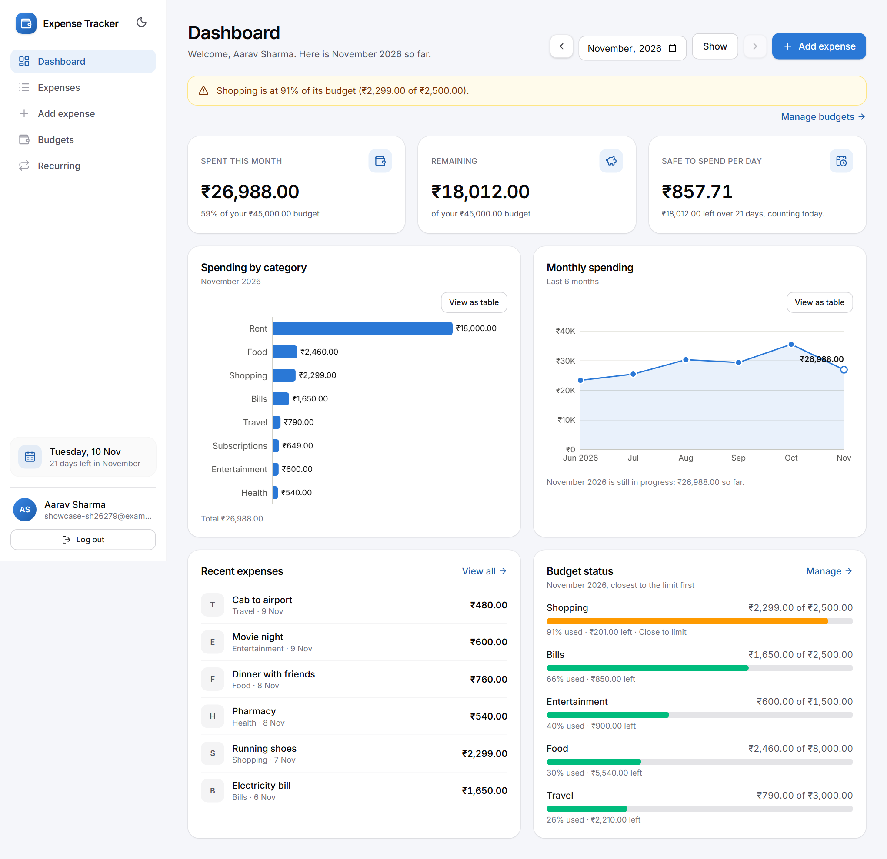
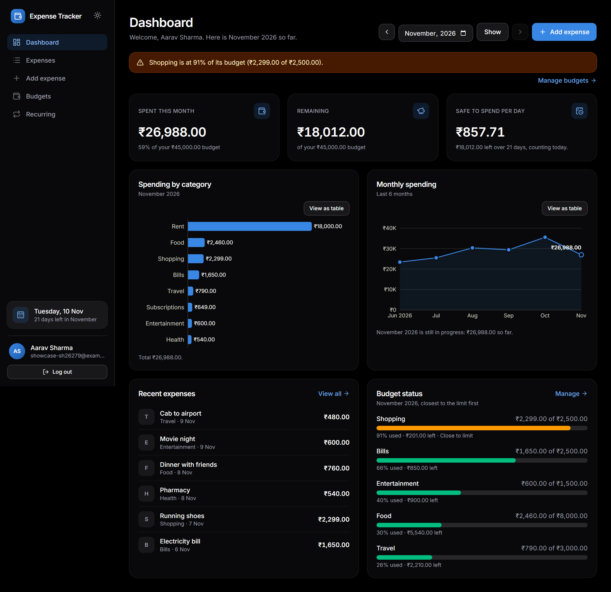
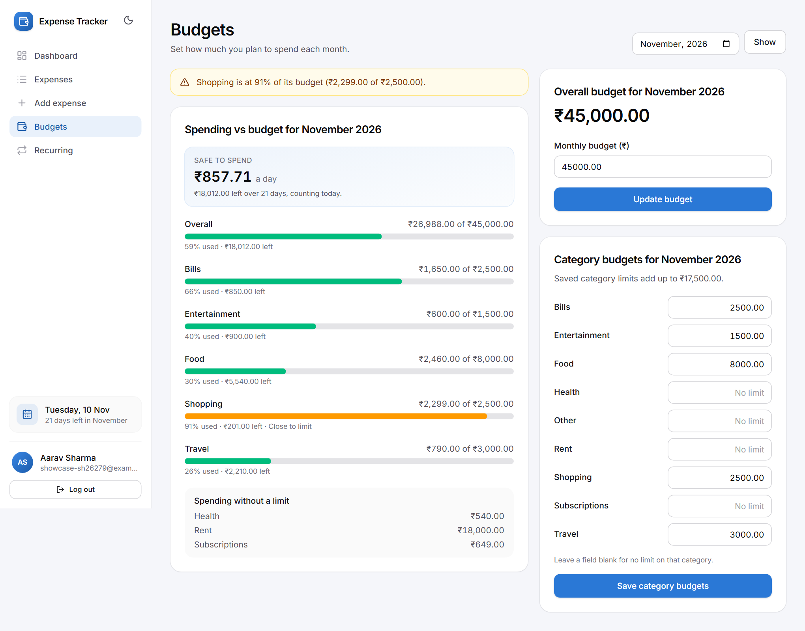
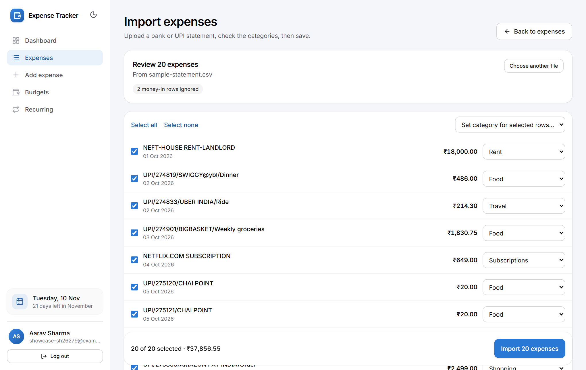
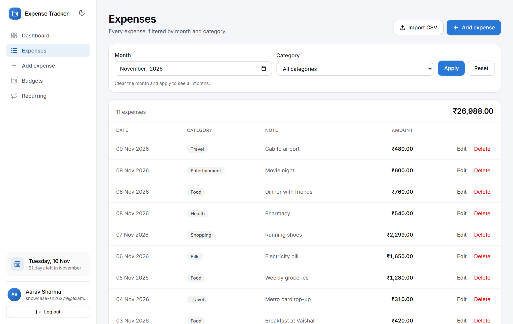
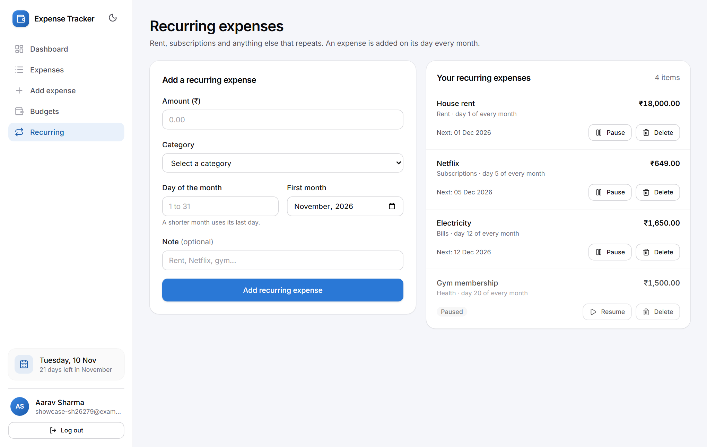
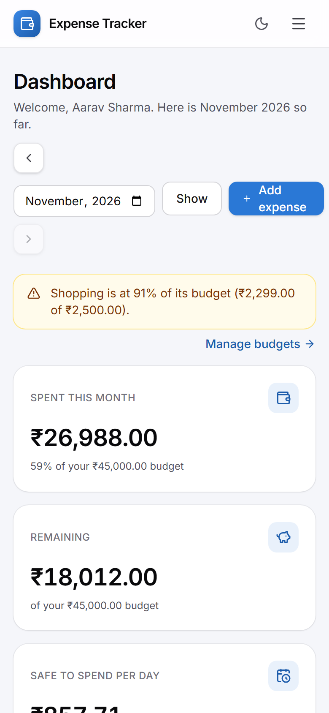
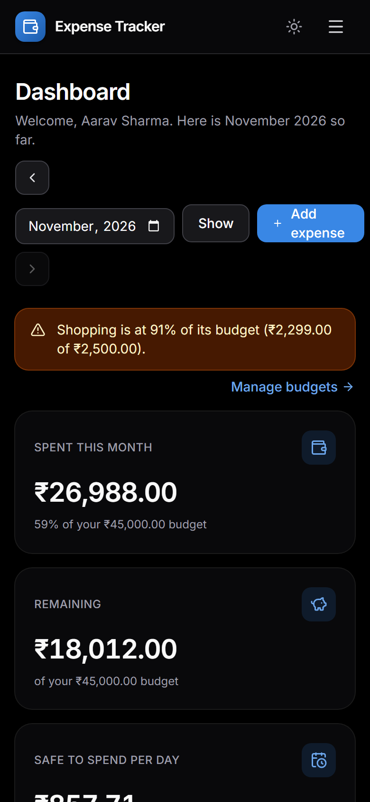

# Expense Tracker

A budget-focused expense tracker built with Next.js, TypeScript, Prisma and PostgreSQL.
Set category budgets, get overspend alerts, and see your daily safe-to-spend amount.

> **Status: Weeks 1 and 2 complete, Week 3 in progress.** Accounts, expense management,
> budgets with alerts and safe-to-spend, a dashboard with charts and a month selector, and
> CSV import (with auto-categorisation, a review step and duplicate detection) work. Automated
> tests and deployment are still to come.
> See [Progress](#progress) for exactly what is and is not built.

## Screenshots

| Dashboard (light) | Dashboard (dark) |
|---|---|
|  |  |

| Budgets and alerts | CSV import review |
|---|---|
|  |  |

| Expenses | Recurring expenses |
|---|---|
|  |  |

| Phone (light) | Phone (dark) |
|---|---|
|  |  |

The data shown is a demo account, not real spending.

## Progress

| Phase | Scope | Status |
|---|---|---|
| Week 1: Foundation | Sign-up, login/logout, protected routes, responsive layout, add / list / filter / edit / delete expenses | **Done** |
| Week 2: Budgets and dashboard | Monthly and per-category budgets, progress bars, overspend alerts, safe-to-spend per day, summary cards, charts | **In progress:** budgets, progress bars, alerts, safe-to-spend, the summary cards and both charts (category breakdown, six-month trend) and the dashboard month selector (earlier months, via `?month=YYYY-MM`) are done, and empty, loading and error states are done; only the Week 2 review is left |
| Week 3: Import, tests, deploy | CSV import with auto-categorisation, Vitest unit tests, Vercel deployment | **In progress:** CSV import (parsing, auto-categorisation, review and fix, duplicate detection) is done; Vitest tests and deployment are not |
| Final: Polish | Screenshots, live link, README finish | Not started |

### What works today

- **Interface:** a public landing page, split-screen login and sign-up, an app shell with a sidebar (mobile menu on phones), a dashboard with a two-column chart grid plus recent expenses and budget status, expense forms next to a list of recent expenses, loading skeletons and a styled 404. Logged-in visitors to `/` go straight to the dashboard.
- **Empty, loading and error states:** every page has an empty state that says what is missing and offers the next step; loading skeletons keep the page's shape while data streams in; if the database is unavailable a page shows a "Something went wrong" card with Try again (the sidebar stays), and a failed save shows a message and keeps what was typed. Error details are logged on the server and never shown.
- **CSV import** (`/expenses/import`, from the Expenses page): upload a bank or UPI statement and review it before anything is saved.
  - Parsing (papaparse) finds the header row, handles Debit/Credit columns or one Amount column (with a Dr/Cr type, a minus sign or a Dr/Cr suffix), and reads dates like 2026-11-09, 09/11/2026 (day first) and 9-Nov-2026. Money-in rows are ignored; rows it cannot read are listed with the reason.
  - Categories are suggested from the description with keyword rules (Swiggy is Food, Uber is Travel, and so on), matched to your own category names; anything unmatched goes to "Other", or you choose one.
  - The preview lets you change any category, untick rows, or set a category for all selected rows.
  - Rows with the same date, amount and description as an existing expense are marked "Already added" and left out, so importing the same file twice adds nothing. A genuine repeat purchase in one file is kept. The server checks again when you confirm.
  - Limits: 800 KB and 2,000 rows per file. A sample file is at `public/sample-statement.csv`.
- **Accounts:** email and password sign-up (Zod validation, bcrypt hashing), login and logout with Auth.js, sessions that survive a reload.
- **Protected routes:** `/dashboard`, `/expenses/*` and `/budgets` redirect logged-out visitors to the login page and back again afterwards. Logged-in users are kept out of the login and sign-up pages.
- **Expenses:**
  - add, edit and delete (delete asks for confirmation);
  - list filtered by month and category, with the count and total for the filter;
  - amounts entered in rupees, stored as integer paise;
  - 9 default categories created for every new account.
- **Budgets** (`/budgets`, one month at a time):
  - an overall monthly budget and a limit per category (a blank field means no limit);
  - progress bars per budget: green below 80%, amber from 80%, red at 100% and over;
  - warning banners from 80%, and red banners when a budget is used up or exceeded, also shown on the dashboard;
  - **safe to spend per day:** what is left of the overall budget divided by the days left in the month, counting today and rounded down to the paisa.
- **Dashboard** (current month): the budget alerts plus three summary cards:
  - spent this month, with the share of the overall budget used;
  - remaining of the overall budget (shown in red and negative when overspent);
  - safe to spend per day.
- **Spending by category** chart on the dashboard: ranked horizontal bars (Recharts), largest first,
  with each amount at the bar tip, a hover tooltip, and a "View as table" toggle listing every
  category with its exact share. With more than 8 categories the smallest are grouped as "All other".
- **Monthly spending** trend chart on the dashboard: a line with an area wash for the last six
  months (the current month and the five before it, in the app time zone). Months with no spending
  show as zero. The current month is month-to-date, so its marker is hollow and its tooltip says
  "so far". The latest month and the peak are labelled; the y axis uses clean round ticks; and a
  "View as table" toggle lists every month with its exact total.
- **Responsive layout:** sidebar on laptop widths, top bar with a menu on phones.

### Not built yet

- Recurring expenses, Google login.
- More automated tests. `npm test` runs 257 unit tests for money handling, the budget helpers, "today" and "this month" in different time zones, the categorisation rules, the password rules, the reset-link helpers and the email wording. The CSV import and recurring-expense logic have no Vitest tests yet. Screens and database writes were checked with browser-driven scripts that are not part of the repo.

## Tech stack

| Layer | Choice |
|---|---|
| Framework | Next.js 16 (App Router, Turbopack, Cache Components) and TypeScript |
| Database | PostgreSQL (Neon) |
| ORM | Prisma 7 with the `pg` driver adapter |
| Auth | Auth.js (`next-auth` v5 beta), credentials provider, JWT sessions |
| Validation | Zod 4 |
| UI | Tailwind CSS 4, Base UI, lucide-react, Inter font |
| Charts | Recharts |
| Tests | Vitest (unit tests for the pure logic in `lib/`) |
| Hosting (planned) | Vercel |

## Getting started

You need Node.js 20 or newer and a PostgreSQL database (a free [Neon](https://neon.tech) database works).

```bash
npm install                 # also generates the Prisma client
cp .env.example .env        # then fill in the values below
npx prisma migrate deploy   # create the tables
npx prisma db seed          # optional: demo user and categories (local use only)
npm run dev                 # http://localhost:3000
```

### Environment variables

| Variable | Purpose |
|---|---|
| `DATABASE_URL` | PostgreSQL connection string. Use `sslmode=verify-full`. |
| `AUTH_SECRET` | Signs session cookies. Generate one with `openssl rand -base64 32`. |
| `AUTH_URL` | Public URL of the app. `http://localhost:3000` locally; the live URL when deployed. |
| `SMTP_USER`, `SMTP_PASSWORD` | Forgot-password and welcome emails through any SMTP account. A free Gmail account works: turn on 2-step verification and create an [app password](https://myaccount.google.com/apppasswords). Optional `SMTP_HOST` (default `smtp.gmail.com`) and `SMTP_PORT` (default `465`). Without email settings, local development prints the reset link in the server log; production needs them. |
| `RESEND_API_KEY` | Alternative to SMTP: send through [Resend](https://resend.com). It only delivers to your own account email until you verify a domain. |
| `EMAIL_FROM` | Optional sender, for example `Expense Tracker <you@gmail.com>`. Gmail only sends as your own address. |
| `APP_TIME_ZONE` | Optional. IANA time zone that decides what "today" and "this month" mean. Defaults to `Asia/Kolkata`. |

`.env` is git-ignored. Never commit real credentials.

### Scripts

| Command | What it does |
|---|---|
| `npm run dev` | Start the dev server |
| `npm run build` | Generate the Prisma client, then build for production |
| `npm start` | Run the production build |
| `npm run lint` | Run ESLint |
| `npm test` | Run the unit tests once (`npm run test:watch` re-runs them as you edit) |

The generated Prisma client (`src/generated/prisma`) is not committed. `npm install` and `npm run build` both generate it, so a fresh clone builds without extra steps.

### Running the tests

Tests live next to the code they check, as `lib/*.test.ts`, and import with the same `@/` paths as the app. They need no database or browser.

| File | What it covers |
|---|---|
| `lib/money.test.ts` | Rupees to paise, formatting, rejected amounts |
| `lib/budget.test.ts` | Percent used, the 80% and 100% thresholds, summaries, alerts, days left in a month, safe to spend per day (including over budget, the last day and leap years) |
| `lib/time.test.ts` | "Today" and "this month" around midnight in several time zones |
| `lib/auto-categorize.test.ts` | Known and unknown merchants, whole-word matching, rule priority, and checks on the rule table itself |

`package.json` overrides `rollup` with its WebAssembly build (`@rollup/wasm-node`). Vitest's bundler normally loads a native add-on, and on machines where Windows Application Control blocks unsigned native files that fails with "An Application Control policy has blocked this file". The WebAssembly build behaves the same and works everywhere; it is only used when running tests, not by the app or `next build`.

### Demo account

`npx prisma db seed` creates `demo@example.com` with the password `demo12345`.
This is for local development only. Do not run the seed against a production database.

### Migrations

Apply migrations with `prisma migrate deploy`. One migration adds a partial unique index
(`Budget_overall_userId_month_key`) that Prisma cannot express in `schema.prisma`, so a
future `prisma migrate dev` may try to drop it. Read any generated migration before applying it.

## Project structure

```
app/
  (app)/                 signed-in pages sharing the sidebar layout
    dashboard/           summary cards, charts, recent expenses, month selector
    expenses/            list, add (new/) and edit ([id]/edit/)
  api/auth/[...nextauth] Auth.js route handler
  login/  sign-up/       public auth pages
components/app/          navigation, expense form, delete dialog
lib/                     db client, auth, money and date helpers, validation schemas
prisma/                  schema, migrations, seed
proxy.ts                 route protection (the Next 16 name for middleware)
```

## Design notes

- **Money is integer paise.** `₹199.50` is stored as `19950`. Input is parsed with string
  arithmetic, never floating point, and the column is a 32-bit integer (maximum ₹21,474,836.47).
- **Dates are calendar dates.** An expense date is stored at UTC midnight, so it never shifts
  into another day or month because of a time zone. Month filters use the same boundaries.
- **One app time zone.** The server cannot know each user's time zone, so "today" and the
  current month follow `APP_TIME_ZONE` (default `Asia/Kolkata`). This is what the safe-to-spend
  figure counts days from, and it rolls over at local midnight, not UTC midnight. An invalid
  value fails with a clear message in the server log.
- **Budget maths is pure.** `lib/budget.ts` has no database, clock or other imports; callers pass
  the data and today's date in, so every rule (thresholds, alerts, safe-to-spend) is easy to test.
- **Authorisation does not rely on the proxy alone.** `proxy.ts` redirects early, but every
  protected page and every server action checks the session itself, and every query is scoped
  to the signed-in user's id. Updates and deletes match on both the record id and the user id.
- **The database client is created on first use**, so building without `DATABASE_URL` works.
  The first query without it fails with a clear message.

## Known limitations

- Forgot-password emails are limited to 3 per account per hour, but login and sign-up have no rate limiting yet, and there is no email verification. After a password change or reset, other devices stay logged in until their session expires.
- Sign-up reveals whether an email is already registered.
- The expense list shows the latest 100 matches (the total still covers all of them); there is no pagination.
- `npm audit` reports findings in development tooling (`shadcn`, `eslint-config-next`, `typescript-eslint`).
  None are in runtime dependencies, and none have been force-fixed.
- `next-auth` v5 is still a beta release.
- Category chart colours are fixed per chart, not per category: the bars are one hue because a donut or pie with stable per-category colours cannot keep every neighbouring pair of slices distinguishable. Identity comes from the labels.
